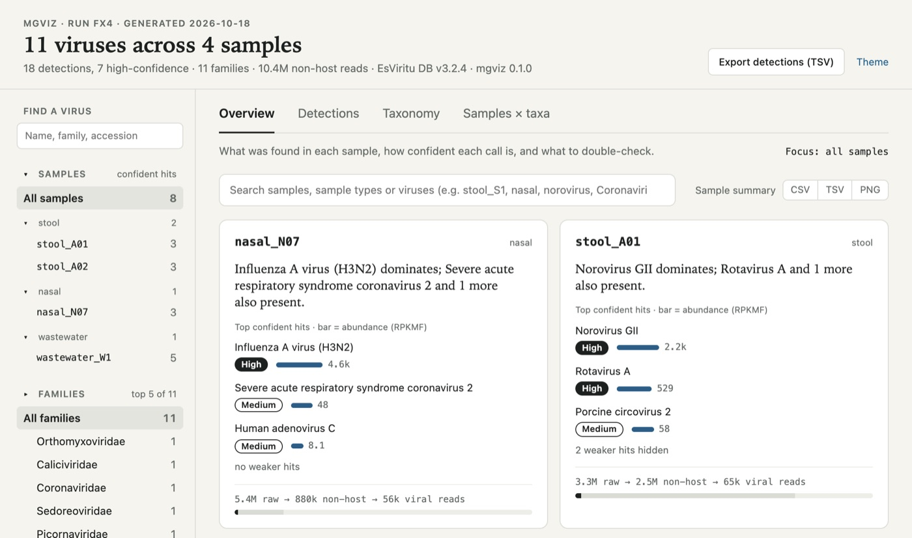
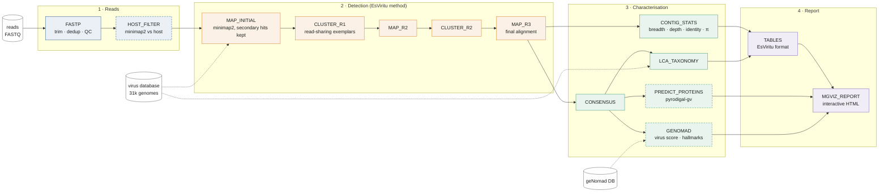
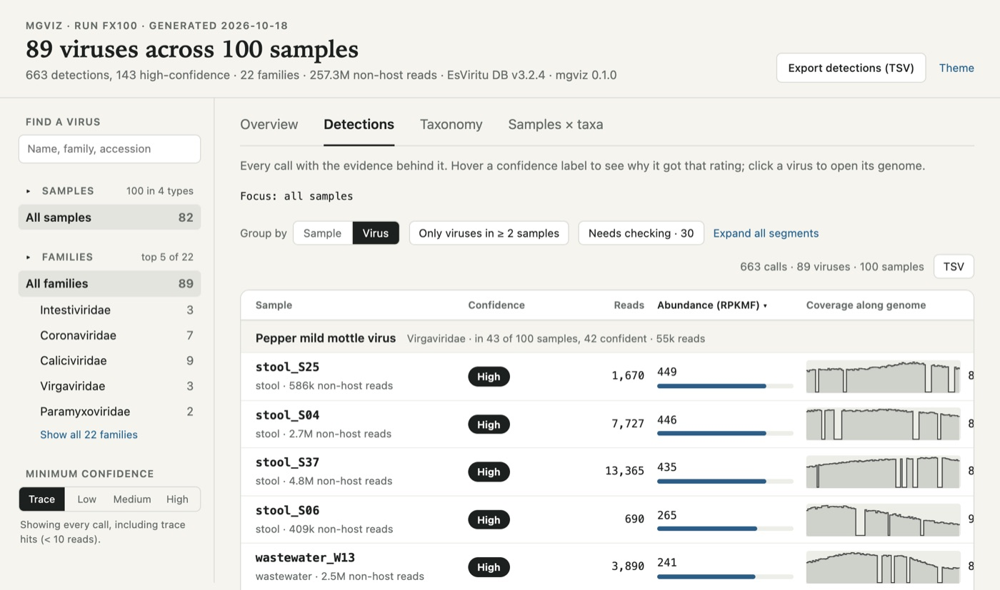
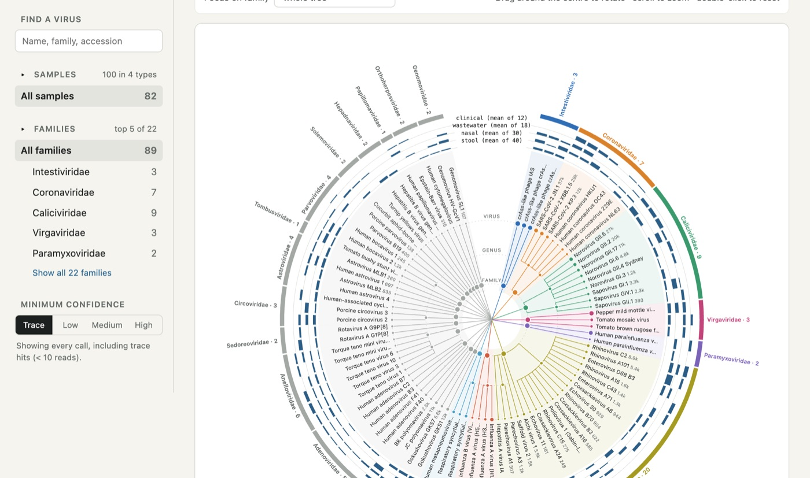
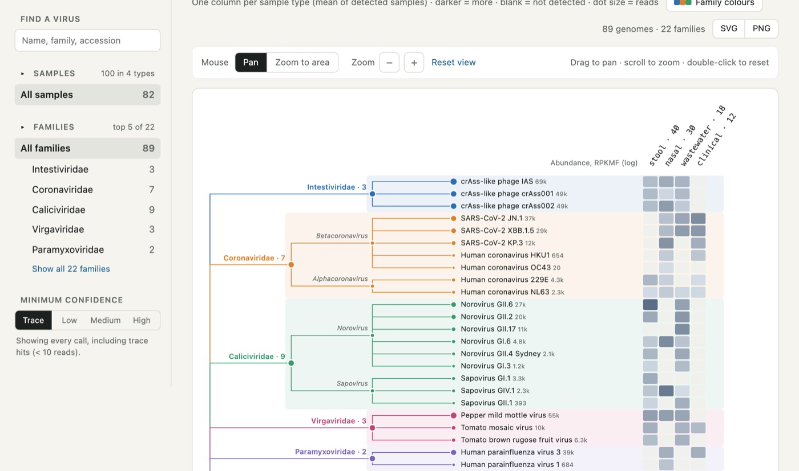
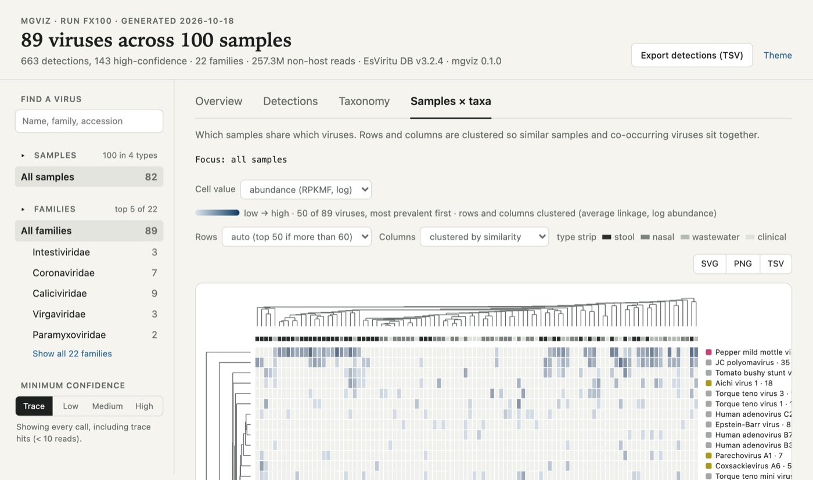
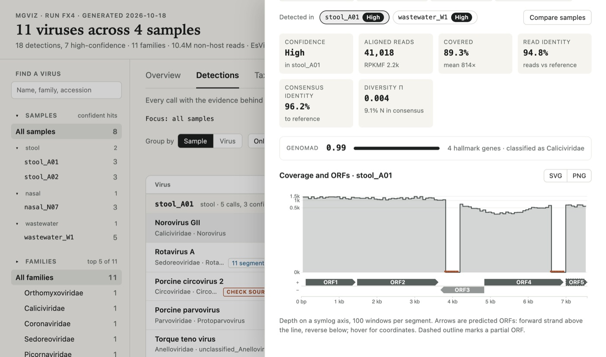
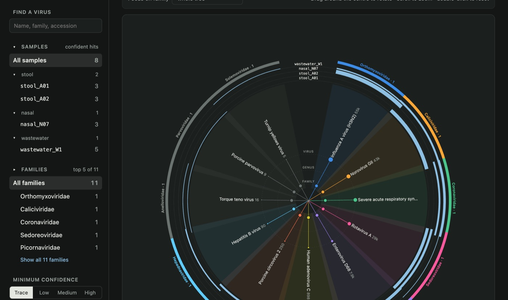

# mgviz

[](https://github.com/loukesio/mgviz/actions/workflows/ci.yml)
[](https://github.com/loukesio/mgviz/actions/workflows/docker.yml)
[](https://www.nextflow.io/)
[](https://ghcr.io/loukesio/mgviz)
[](https://sylabs.io/docs/)
[](LICENSE)
[](https://loukesio.github.io/mgviz/)


**mgviz** detects viruses in short-read metagenomes and explains every call in an
interactive report. Reads are mapped to a reference database of ~31,000 viral
genomes, the genomes that are really present are selected by read-sharing
clustering, a consensus is built for each one, taxonomy is assigned by lowest
common ancestor, proteins are predicted and every consensus is scored with
geNomad. The result is one self-contained HTML report: which viruses are in which
samples, how much to trust each call, where each detection sits in viral
taxonomy, and the coverage and genes of every genome.

The analysis follows [EsViritu](https://github.com/cmmr/EsViritu) (Tisza *et al.*)
step by step, re-implemented as independent Nextflow processes so that each step
can be run, tested and replaced on its own. EsViritu output directories are also
accepted directly by the report.

<p align="center"></p>

**Try the report now:** [loukesio.github.io/mgviz](https://loukesio.github.io/mgviz/) hosts
two live demo reports, 4 and 100 synthetic samples. Everything in them is clickable.

## Contents

- [What mgviz adds over EsViritu](#what-mgviz-adds-over-esviritu)

- [Pipeline summary](#pipeline-summary)
- [Quick start](#quick-start)
- [The report](#the-report)
- [Inputs](#inputs)
- [Databases](#databases)
- [Parameters](#parameters)
- [Profiles and resources](#profiles-and-resources)
- [Outputs](#outputs)
- [Running one step at a time](#running-one-step-at-a-time)
- [Container](#container)
- [Report only](#report-only)
- [Development](#development)
- [Credits and citations](#credits-and-citations)

## What mgviz adds over EsViritu

The detection method is EsViritu's, re-implemented with care and credited. What is
built on top of it is new:

| | EsViritu | mgviz |
|---|---|---|
| Execution | one Python command per sample, run one after another | Nextflow: samples in parallel, resumable, any executor (local, SLURM, cloud), one validated container, schema-checked parameters, bundled test profile |
| Steps | fixed sequence inside one script | thirteen independent processes, each runnable alone, with `ext.args` to change any tool's flags |
| Evidence per call | reads, coverage, identity in a table | the same plus a confidence tier (High / Medium / Low / Trace) with the rule shown on hover, and "Needs checking" flags for divergent genomes, low geNomad scores and animal viruses in human samples |
| Annotation | none | ORFs for every consensus (pyrodigal-gv) and geNomad virus score, hallmark genes and ICTV taxonomy as an independent check on the mapping |
| Cross-sample view | none; one report per run | Overview with per-sample stories, shared and prevalent viruses, QC funnel; Samples × taxa heatmap clustered on both axes |
| Taxonomy | a static PNG tree of the database | interactive trees of the results: rectangular with per-sample columns, radial publication figure with rings and family arcs that rotates and zooms to a family, composition icicle and bars |
| Genome view | a 100-window sparkline | genome drawer with depth, ORF arrows, geNomad strip, per-segment panels for segmented viruses and overlay of the same genome across samples |
| Export | TSV | SVG and PNG of every figure, CSV and TSV of every table, full data bundle as JSON |
| Design | default reactable styling | one focus model across all views, light and dark themes, colour-blind-safe family palettes, every colour and number tied to a question |
| Provenance | log file | software versions, timeline, trace and DAG for every run |

EsViritu output directories are still accepted directly by `mgviz report`, so
existing runs can be explored in the new report without re-running anything.

## Pipeline summary



Dashed boxes are optional steps (`--filter_fasta`, `--predict_proteins`, `--genomad_db`).

| Step | Tools | What it does |
|---|---|---|
| FASTP | fastp | adapter and quality trimming, read counts for the QC funnel |
| HOST_FILTER | minimap2, samtools | removes reads mapping to a host or spike-in FASTA (`--filter_fasta`) |
| MAP_INITIAL | minimap2, samtools | maps every read to the full database (`--secondary=yes -N 100 -p 0.90`), keeps alignments ≥ 100 nt, ≥ 90 % of the read, ≥ 80 % identity |
| CLUSTER_R1 / CLUSTER_R2 | mgviz | builds the read-sharing network between references and keeps one exemplar per cluster (share ≥ 0.33 of the smaller genome; most reads wins) |
| MAP_R2 / MAP_R3 | minimap2, samtools | re-maps the virus reads to the exemplars, twice, as EsViritu does |
| CONSENSUS | samtools consensus | consensus sequence per detected genome (`-m simple -q -c 0.51`) |
| CONTIG_STATS | mgviz, pysam | covered bases, mean depth, read identity, nucleotide diversity π, depth in 100 windows |
| LCA_TAXONOMY | minimap2, mgviz | consensus-to-database identity, taxonomy downgraded below the species (0.90) and subspecies (0.95) thresholds |
| PREDICT_PROTEINS | pyrodigal-gv | ORFs on every consensus |
| GENOMAD | geNomad | virus score, hallmark genes and ICTV taxonomy for every consensus |
| TABLES | mgviz | EsViritu-compatible per-sample tables and YAML |
| MGVIZ_REPORT | mgviz, d3 | the interactive report for the whole run |

## Quick start

1. Install [Nextflow](https://www.nextflow.io/docs/latest/install.html) (≥ 23.10) and Docker, Singularity or conda.

2. Download the EsViritu database (≈ 400 MB decompressed) and, optionally, the geNomad database (see [Databases](#databases)):

   ```bash
   mkdir -p db && cd db
   wget https://zenodo.org/records/17716199/files/esviritu_db_v3.2.4.tar.gz
   tar xzf esviritu_db_v3.2.4.tar.gz && cd ..
   ```

3. Write a samplesheet (see [Inputs](#inputs)):

   ```csv
   sample,fastq_1,fastq_2,type
   stool_S01,/data/stool_S01_R1.fastq.gz,/data/stool_S01_R2.fastq.gz,stool
   nasal_N01,/data/nasal_N01.fastq.gz,,nasal
   ```

4. Run:

   ```bash
   nextflow run loukesio/mgviz -r main -profile docker \
       --samplesheet samples.csv \
       --db db/v3.2.4 \
       --genomad_db db/genomad_db \
       --outdir results
   ```

   Open `results/mgviz_report.html`. On a cluster, add `-profile docker,slurm`
   (or `singularity,slurm`). `nextflow run loukesio/mgviz --help` lists every
   parameter.

To check an installation first, run the bundled test data (two simulated
samples against a 53-genome database, a few minutes on a laptop):

```bash
nextflow run loukesio/mgviz -profile test,docker --outdir results_test
```

## The report

The report is one HTML file that opens offline from disk. Four views share one
focus (sample, family, search text, minimum confidence) and every figure exports
as SVG or PNG, every table as CSV or TSV.

**Overview.** The story per sample: what dominates, how confident each call is,
and the raw → non-host → viral read funnel. Above 12 samples the cards become a
sortable "Samples at a glance" table, and the shared-viruses panel becomes a
prevalence-by-sample-type table.

**Detections.** Every call with the evidence behind it: a confidence tier
(High, Medium, Low, Trace) explained on hover, reads, abundance (RPKMF),
coverage along the genome, read and consensus identity, geNomad score.
Segmented viruses are one row with their segments nested. "Needs checking"
lists calls whose numbers disagree: DIVERGENT (consensus identity below the
species threshold, a possible new variant), LOW GENOMAD (good coverage but a low
virus score), CHECK SOURCE (an animal virus in a human sample).

<p align="center"></p>

**Taxonomy.** Where each detection sits, with single-child rank chains folded
away: a rectangular tree with one abundance column per sample (or per sample
type), a radial publication figure with rank guides, bar rings and family arcs
that can be rotated and zoomed to a family, and a composition view (icicle plus
100 % stacked bars per sample). Family colours come from the
[ltc](https://github.com/loukesio/ltc-color-palettes) palettes and can be
edited per family.

<p align="center"></p>
<p align="center"></p>

**Samples × taxa.** A heatmap with rows and columns clustered by similarity
(UPGMA on log abundance), or columns grouped by sample type, down to 100
samples by 200 viruses.

<p align="center"></p>

**Genome drawer.** Click any virus: lineage, the samples it was found in with
their tiers, evidence tiles, the geNomad strip, and coverage with ORF arrows per
segment, with a compare mode that overlays the samples.

<p align="center"></p>

Light and dark themes follow the system and can be toggled in the header.

<p align="center"></p>

Confidence tiers are computed from the data, not stored:

| Tier | Rule |
|---|---|
| High | ≥ 80 % of the genome covered, ≥ 500 reads, read identity ≥ 90 %, geNomad score ≥ 0.8 |
| Medium | ≥ 40 % covered and ≥ 50 reads |
| Low | ≥ 10 reads |
| Trace | everything else |

If geNomad was not run, that check is reported as "not run" and High needs the
other three.

## Inputs

**Samplesheet** (`--samplesheet`), CSV with a header:

| Column | Required | Description |
|---|---|---|
| `sample` | yes | sample name, used for every output file |
| `fastq_1` | yes | gzipped FASTQ (R1, or single-end reads) |
| `fastq_2` | no | gzipped FASTQ R2; leave empty for single-end |
| `type` | no | `stool`, `nasal`, `wastewater` or `clinical`; groups the report by sample type. Inferred from the name prefix (`stool_S01`) when absent |

**Reads.** Illumina paired or single-end short reads. Long reads work with
`--mm_preset map-ont` or `map-hifi`.

## Databases

| Database | Parameter | Source |
|---|---|---|
| EsViritu virus database v3.2.4 (`virus_pathogen_database.fna`, `.mmi`, `.all_metadata.tsv`) | `--db` | [Zenodo 10.5281/zenodo.17716199](https://doi.org/10.5281/zenodo.17716199) |
| geNomad database v1.9 | `--genomad_db` (optional) | `genomad download-database db/` or the [geNomad releases](https://github.com/apcamargo/genomad) |
| Host or spike-in FASTA | `--filter_fasta` (optional) | e.g. a human reference |

The EsViritu database is curated for human and animal viruses and is the right
default for clinical, respiratory and stool samples. For wastewater and other
environmental samples, [docs/databases.md](docs/databases.md) describes an
extended database (EsViritu plus RefSeq viral, built with
`mgviz.pipeline.db_sources`) and how to benchmark it before adopting it.

To build your own database in the same format from a FASTA, an accession table
and the NCBI taxdump, use the standalone `BUILD_DB` module:

```bash
nextflow run modules/local/build_db/main.nf -profile docker \
    --db_fasta my_genomes.fna --db_table my_table.tsv --db_name mydb \
    --taxdump taxdump/ --acc2taxid nucl_gb.accession2taxid.gz --db_outdir db
```

## Parameters

| Parameter | Default | Description |
|---|---|---|
| `--samplesheet` | | samplesheet CSV (required) |
| `--db` | | EsViritu-format database directory (required) |
| `--outdir` | `results` | output directory |
| `--title` | `mgviz report` | report title |
| `--filter_fasta` | `null` | host / spike-in FASTA; enables HOST_FILTER |
| `--genomad_db` | `null` | geNomad database; enables GENOMAD |
| `--genomad_splits` | `0` | mmseqs2 database splits for geNomad; set to 8 on machines with < 16 GB |
| `--predict_proteins` | `true` | run pyrodigal-gv |
| `--min_aln_len` | `100` | minimum aligned length (nt) |
| `--min_read_cov` | `0.90` | minimum aligned fraction of the read |
| `--min_identity` | `0.80` | minimum alignment identity |
| `--min_read_len` | `50` | minimum read length after trimming |
| `--mm_preset` | `sr` | minimap2 preset: `sr`, `map-ont`, `map-hifi` |
| `--mm_k` | `500M` | minimap2 batch size |
| `--share_thresh` | `0.33` | read-sharing fraction that joins two references into one cluster |
| `--sp_thresh` | `0.90` | consensus identity below which the species is downgraded |
| `--subsp_thresh` | `0.95` | consensus identity below which the subspecies is downgraded |
| `--container` | `ghcr.io/loukesio/mgviz:0.1.0` | image used by every process |

Full descriptions: `nextflow run loukesio/mgviz --help`, or [docs/usage.md](docs/usage.md).

## Profiles and resources

| Profile | Use |
|---|---|
| `docker` | Docker, running as the calling user |
| `singularity` | Singularity / Apptainer with auto-mounts |
| `conda` | conda environment from `environment.yml` |
| `local` | local executor (default) |
| `slurm` | SLURM executor, queue size 50 |
| `test` | bundled test data and database (`assets/test_data/`) |
| `laptop` | Docker Desktop limits: 6 CPUs and 6 GB per task, geNomad split into 8, retries; native arm64 image on Apple silicon |

Processes carry nf-core style labels (`process_single`, `process_low`,
`process_medium`, `process_high`) with resources set in `conf/base.config`,
doubled on retry and capped by `process.resourceLimits` (16 CPUs, 64 GB, 48 h
by default; the `test` and `laptop` profiles lower it).
Tool flags can be changed per process with `ext.args` in a custom config passed
with `-c` (see `conf/modules.config`). Software versions of every run are
collected in `<outdir>/pipeline_info/software_versions.yml` next to Nextflow's
timeline, report, trace and DAG.

## Outputs

```
results/
├── mgviz_report.html                 the report
├── mgviz_bundle.json                 the data behind it
├── fastp/            <sample>.fastp.json, trimmed reads
├── map_initial/      <sample>.bam, virus reads, read count
├── cluster_r1/ cluster_r2/   read-sharing networks, cluster tables, exemplar FASTA
├── map_r2/ map_r3/   refined alignments
├── consensus/        <sample>_final_consensus.fasta
├── contig_stats/     per-contig statistics and 100-window depth
├── lca_taxonomy/     consensus identity and taxonomy adjustments
├── predict_proteins/ <sample>.orfs.tsv, .gff, .faa
├── genomad/          <sample>_final_consensus_virus_summary.tsv
├── pipeline_info/    software_versions.yml, Nextflow timeline, report, trace, DAG
└── tables/<sample>/  EsViritu-compatible tables:
                      <sample>.detected_virus.info.tsv
                      <sample>.detected_virus.assembly_summary.tsv
                      <sample>.tax_profile.tsv
                      <sample>.virus_coverage_windows.tsv
                      <sample>_esviritu.readstats.yaml, _esviritu.params.yaml
```

## Running one step at a time

Every module in `modules/local/` carries its own entry workflow, so a step can
be run alone on existing files:

```bash
nextflow run modules/local/map_initial/main.nf -profile docker \
    --reads 'reads/sample_R{1,2}.fastq.gz' --sample sample --db db/v3.2.4
nextflow run modules/local/mgviz_report/main.nf -profile docker \
    --sample_dirs 'results/tables/*' --samples_tsv samples.tsv
```

## Container

All steps run in one image, `ghcr.io/loukesio/mgviz`, built from the
`Dockerfile` (micromamba, tools pinned in `environment.yml`) and published by
GitHub Actions on every push to `main` and every `v*` tag:

```bash
docker pull ghcr.io/loukesio/mgviz:0.1.0        # linux/amd64
docker pull ghcr.io/loukesio/mgviz:0.1.0-arm64  # native on Apple silicon
docker build -t ghcr.io/loukesio/mgviz:dev .     # local build
```

A `docker save` archive of each release is also attached to Zenodo for
long-term reproducibility.

## Report only

The report can be built from any EsViritu output directory without running the
pipeline:

```bash
pip install git+https://github.com/loukesio/mgviz
mgviz report path/to/esviritu_output --samples samples.tsv --run-id run42 -o report.html

mgviz demo demo_small -o small.html        # three synthetic samples
mgviz demo demo_big -n 100 -o big.html     # 100 typed samples, 22 families
```

`samples.tsv` has the columns `sample` and `type`. The report reads the standard
EsViritu files per sample plus, when present, `<sample>.orfs.tsv` and
`<sample>_final_consensus_virus_summary.tsv` from this pipeline.

## Development

```
main.nf, nextflow.config            entry point, parameters and profiles (nf-core layout)
nextflow_schema.json                parameter schema: validation and --help
workflows/mgviz.nf                  the workflow; subworkflows/local/ groups the clustering rounds and annotation
modules/local/<step>/main.nf        one process per step, each with a standalone entry workflow
conf/                               base resources, module options, test and laptop profiles
assets/test_data/                   53-record database and two simulated samples for -profile test
src/mgviz/
  loader.py, bundle.py, render.py   EsViritu files → JSON bundle → one HTML
  templates/report.html, report.css, js/*.js   the report (d3 v7, inlined)
  pipeline/                         the step CLIs used by the Nextflow modules
  synthetic.py                      synthetic EsViritu outputs for tests and demos
docs/usage.md, output.md, databases.md   usage, outputs, database choices and builds
design_handoff_mgviz_report/        report design specification and prototypes
```

```bash
pip install -e . pytest pysam
pytest -q

# reads with a known truth, sampled from the database (5 random genomes)
python -m mgviz.pipeline.simulate_reads --db db/v3.2.4 --sample sim \
    --accessions random:5 --outdir reads/
```

The design principle of the report: every colour, bar and number must answer a
question. Family colour appears only in the Taxonomy and Samples × taxa views;
confidence is neutral ink, warnings are one accent.

## Credits and citations

mgviz re-implements the analysis of **EsViritu** (M. J. Tisza *et al.*,
[github.com/cmmr/EsViritu](https://github.com/cmmr/EsViritu), MIT) and uses its
database. Please cite EsViritu and the tools below when you publish results:

- Chen S. *et al.* fastp. *Bioinformatics* 2018.
- Li H. minimap2. *Bioinformatics* 2018.
- Danecek P. *et al.* samtools and htslib. *GigaScience* 2021.
- Larralde M. pyrodigal; Hyatt D. *et al.* Prodigal, with the pyrodigal-gv extension.
- Camargo A. P. *et al.* geNomad. *Nature Biotechnology* 2024.
- Bostock M. *et al.* D3: Data-Driven Documents. *IEEE TVCG* 2011.
- Nextflow: Di Tommaso P. *et al.* *Nature Biotechnology* 2017.

To cite mgviz itself, use the metadata in [CITATION.cff](CITATION.cff)
(GitHub shows a "Cite this repository" button).

## License

MIT, see [LICENSE](LICENSE).
